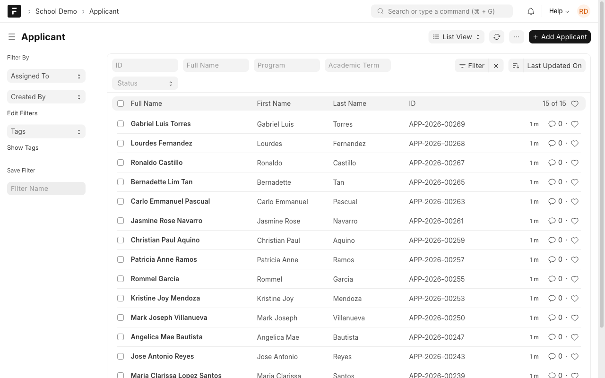
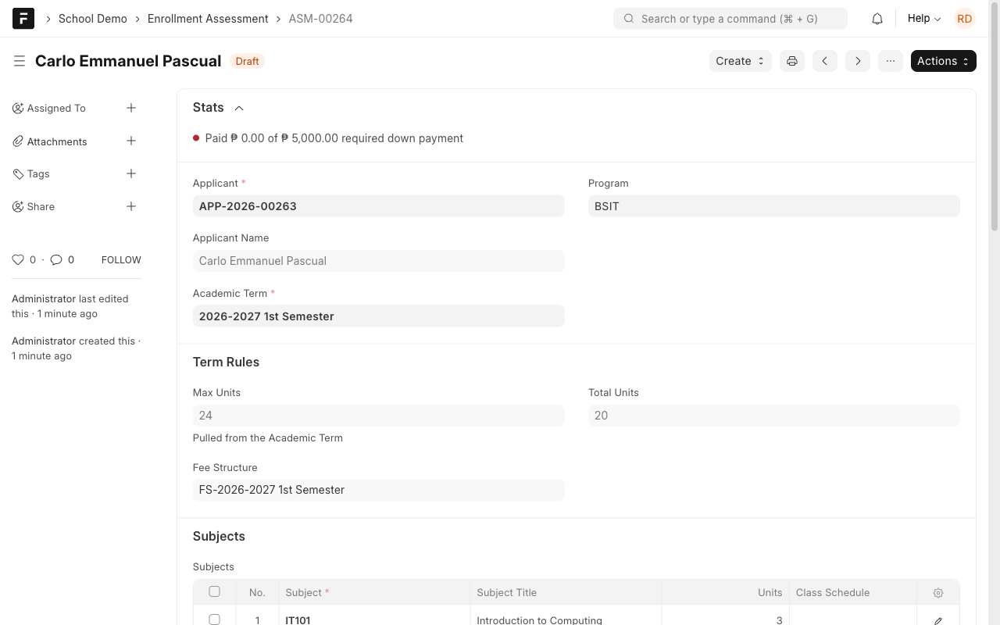
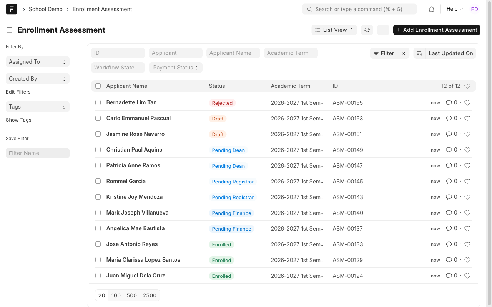
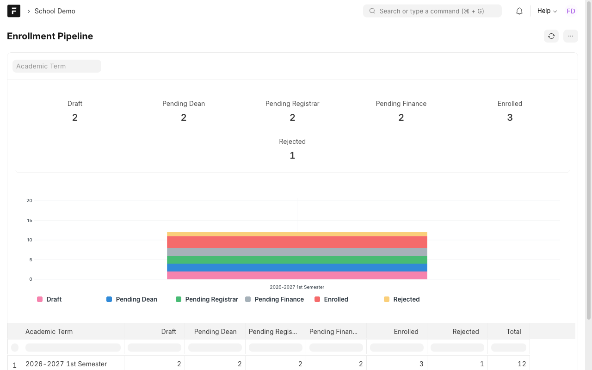
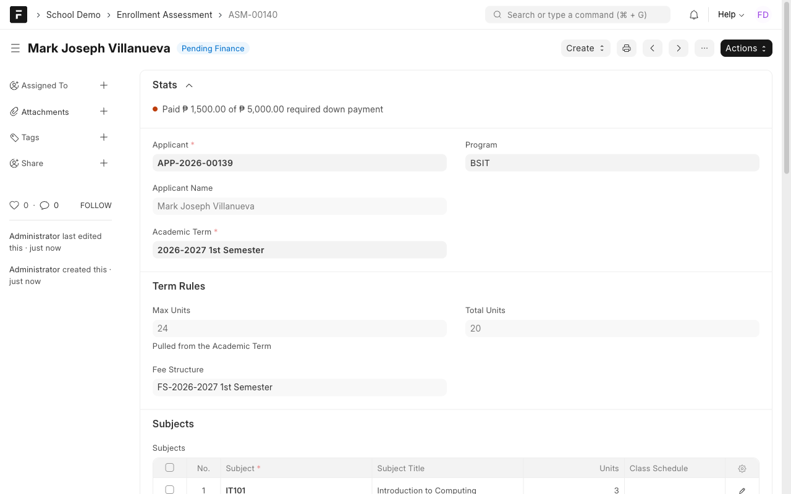
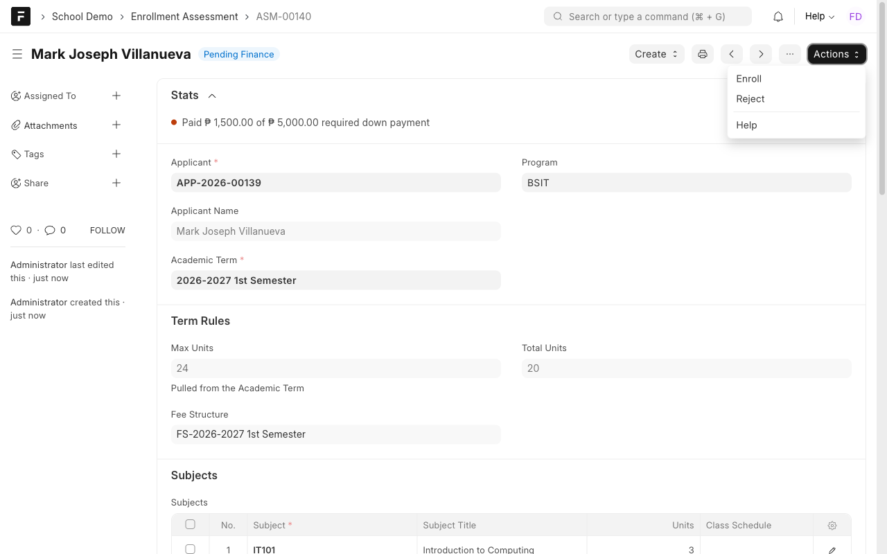
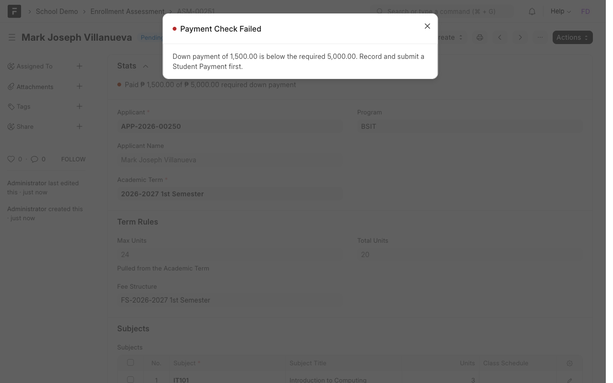

# Manual 1: College admission and enrollment

**What it does.** One path from a new applicant to a locked enrollment, with approvals by the Dean, the Registrar and Finance, and a payment check before anyone can be enrolled.

**Who uses it.** Registrar (applicants and assessments), Dean (first approval), Finance Officer (final step), Cashier (payments).

> **Try it yourself.** Open the demo, sign in with the login shown for this case study (the password is on the demo's `/demo` page), then open the **School Demo** workspace. Record numbers such as `ASM-00251` differ on every site.

Logins: `registrar@demo.local`, `dean@demo.local`, `finance@demo.local`, `cashier@demo.local`.

## The path

`Applicant` → `Enrollment Assessment` (Draft) → **Pending Dean** → **Pending Registrar** → **Pending Finance** → **Enrolled** (locked). At any approval step the approver can **Reject**.

## Steps

### 1. Record the applicant (Registrar)
Open **Applicant** and add the person, their program and the academic term.

### 2. Make the assessment (Registrar)
From the applicant, create an **Enrollment Assessment**. Pick the subjects. The form fills in the term's unit limit, the fee structure and the totals for you.

- **Unit limit.** If the subjects add up to more units than the term allows (24 in the demo), saving is refused with a message that names both numbers.
- **Fees.** Tuition and miscellaneous fees are worked out on the server from the term's fee structure. You cannot type over them.

Then use **Actions** to send the assessment for approval.

### 3. Approvals (Dean, then Registrar)
Each approver opens **Enrollment Assessment**, filters by their state and uses **Actions** (Approve or Reject).

### 4. See where everyone is (anyone with report access)
**Enrollment Pipeline** counts assessments per state and term, with a chart.

### 5. Enroll (Finance Officer)
Open an assessment in **Pending Finance**. The Stats line at the top shows what has been paid against the required down payment.

Open **Actions**:

If the down payment is short, **Enroll is blocked**:

Ask the **Cashier** to create and submit a **Student Payment** for the assessment, then press **Enroll** again. When the paid total reaches the required down payment, the assessment becomes **Enrolled** and locks.

## Rules to know
| Rule | What you see |
| --- | --- |
| Unit limit comes from the academic term | Saving a too-heavy load is refused |
| Fees are computed on the server | Fee fields are read-only |
| Enrolling needs the required down payment | "Payment Check Failed" with the amounts |
| Only submitted Student Payments count | A draft payment is not counted |
| Running enrollment again never wipes an already-enrolled student | Safe to retry |

## If something looks wrong
- **No Enroll in Actions:** the assessment is not in Pending Finance yet, or your login is not a Finance Officer.
- **Payment still short after paying:** the Student Payment is still a draft. Submit it.
