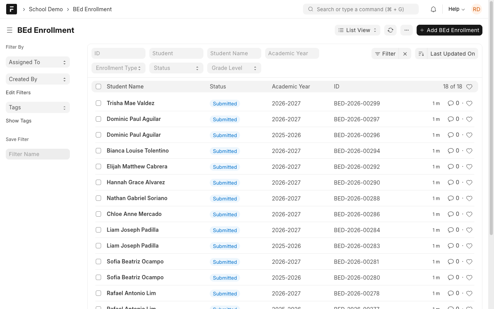
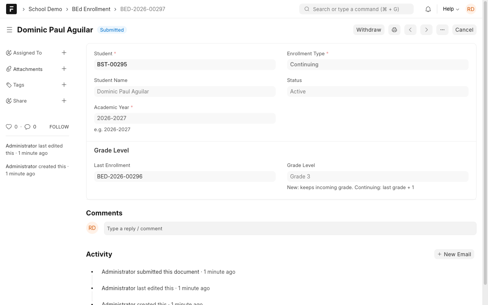
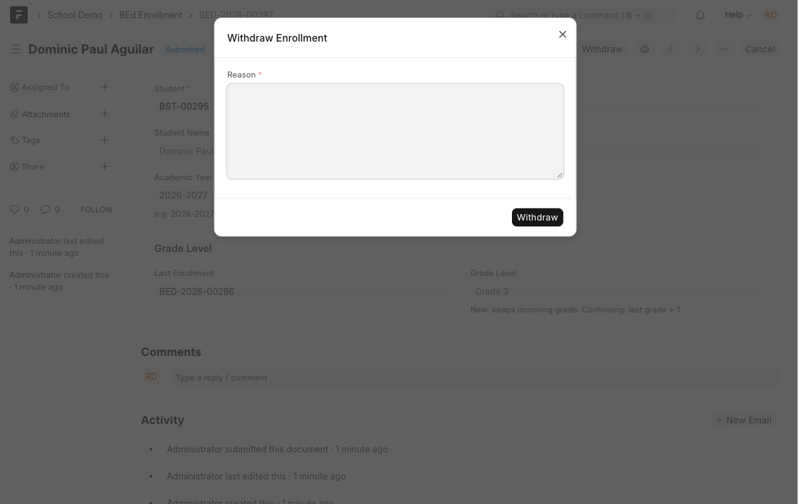
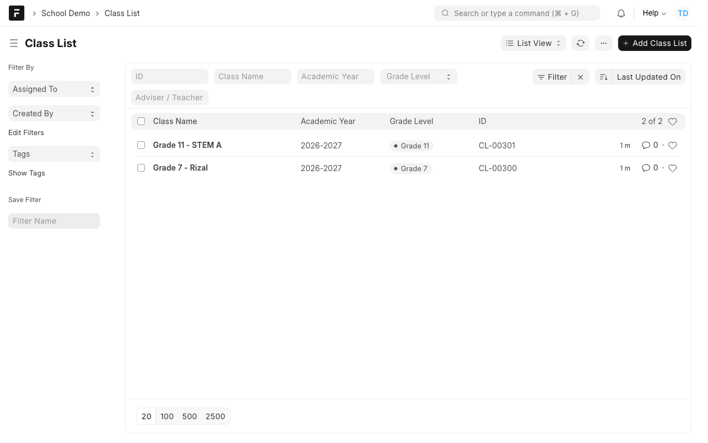

# Manual 2: Basic education enrollment

**What it does.** Enrolls Kinder to Grade 12 learners for a school year, moves continuing learners up one grade, allows one active enrollment per learner per year, and lets the Registrar withdraw a learner. Teachers see only their own classes and grades.

**Who uses it.** Registrar (enrollments, withdrawals), Teacher (class lists and grades).

> **Try it yourself.** Open the demo, sign in with the login shown for this case study (the password is on the demo's `/demo` page), then open the **School Demo** workspace. Record numbers such as `ASM-00251` differ on every site.

Logins: `registrar@demo.local`, `teacher@demo.local`, `teacher2@demo.local`.

## Steps

### 1. Enroll a learner (Registrar)
Open **BEd Enrollment** and add a record for the learner and school year.

- **New** keeps the incoming grade you choose.
- **Continuing** moves the learner up one grade from their last enrollment (Kinder, Grade 1 to Grade 12).
- A learner can have **only one active enrollment per school year**. A second one is refused with a friendly message.

The grade level is filled in for you:

### 2. Withdraw a learner (Registrar)
On a submitted enrollment press **Withdraw** and give a reason.

Withdrawing clears the learner from their class list. For Grade 11 and 12 it also clears their leftover **Student Grade** rows.

### 3. Teachers see only their own classes
A teacher opens **Class List** and **Student Grade**. Each teacher sees only the classes where they are the adviser.

`teacher2@demo.local` sees a different set. A class list always shows the learner's **current** name, even after a rename.

## Rules to know
| Rule | What you see |
| --- | --- |
| One active enrollment per learner per year | Duplicate is refused |
| Continuing = last grade + 1 | Grade level is read-only |
| Withdraw needs a reason | The dialog will not submit without one |
| Teachers see only their own records | Other teachers' classes never appear |
