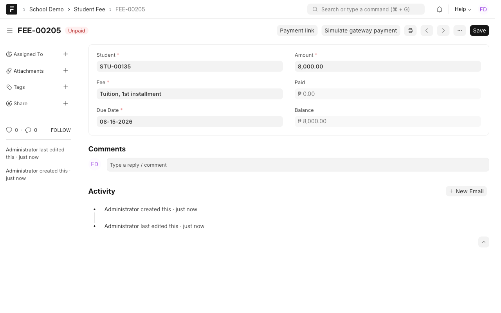
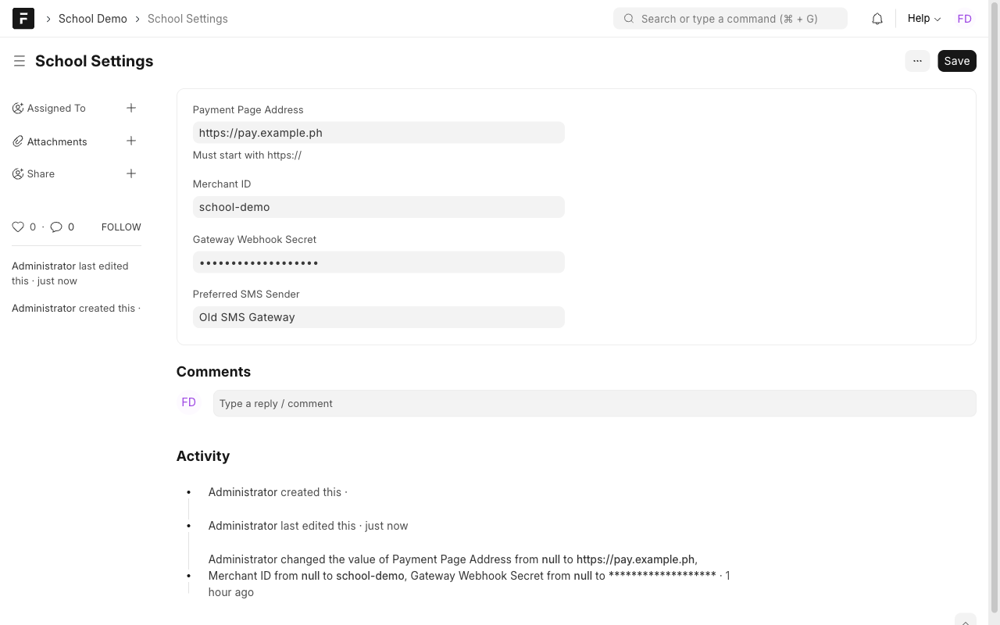
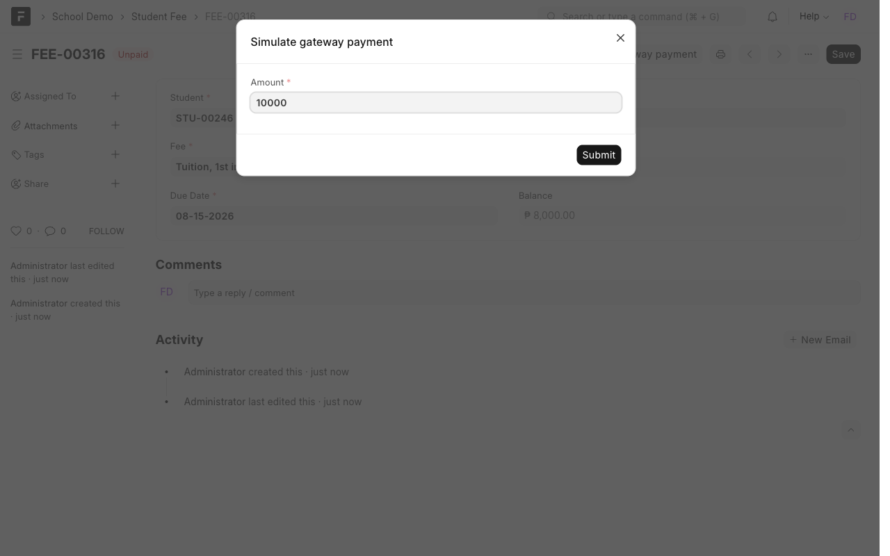
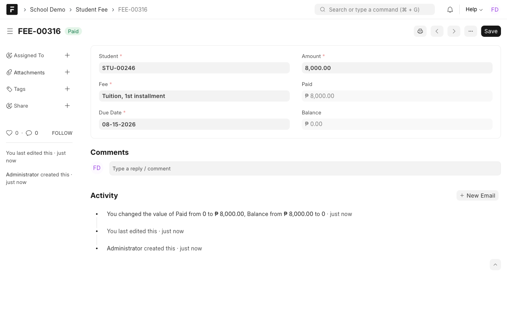
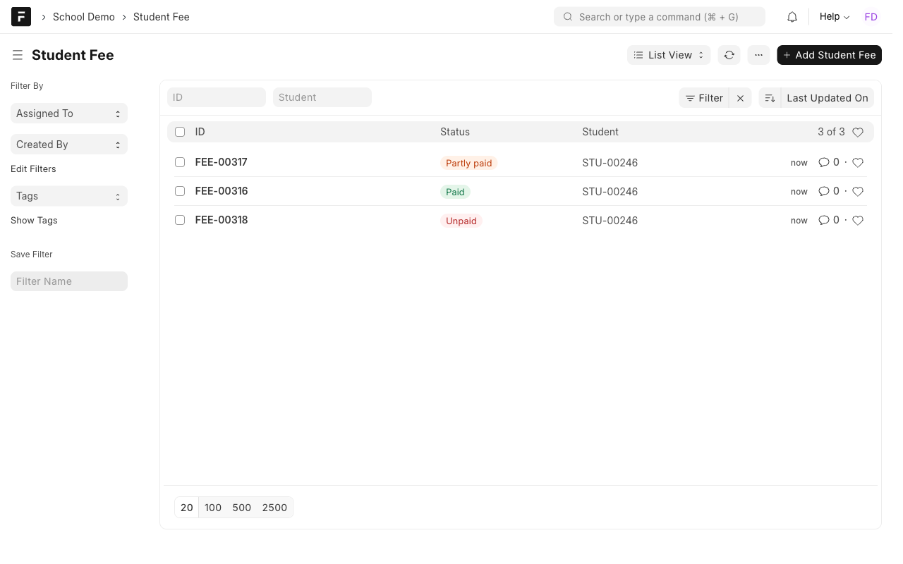
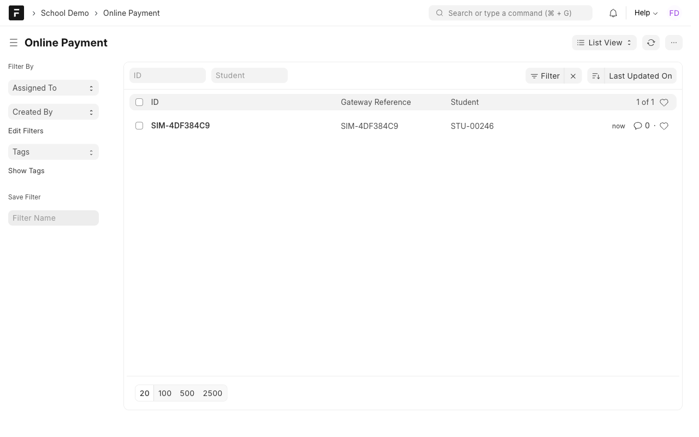

# Manual 3: Online payments

**What it does.** A fee paid through the school's online payment gateway lands on the student's account without anyone retyping it. The gateway tells the system about each payment, and the system applies it to the oldest unpaid fees first.

**Who uses it.** Finance Officer and Cashier (viewing fees and payments), System Manager (settings).

> **Try it yourself.** Open the demo, sign in with the login shown for this case study (the password is on the demo's `/demo` page), then open the **School Demo** workspace. Record numbers such as `ASM-00251` differ on every site.

Login: `finance@demo.local`.

## What staff see

### 1. Fees on a student's account
**Student Fee** lists each fee with a colored status: **Unpaid**, **Partly paid** or **Paid**.

Open a fee to see its amount, what is paid and the balance. **Payment link** builds the link for the payment page from School Settings.

### 2. Payment links come from settings
The payment page address and merchant ID are set once in **School Settings**, not typed into each fee. The address must start with `https://`.

### 3. A payment arrives
In production the gateway sends it. In the demo, press **Simulate gateway payment**. It signs a payment and sends it through the same code path as the real gateway.

The fees are paid **oldest due date first**. In the example, 10,000 clears the first 8,000 fee and puts 2,000 on the next one:

### 4. The payment record
**Online Payment** keeps one record per gateway reference, with the amount, how it was applied and any credit.

## Rules to know
| Rule | What happens |
| --- | --- |
| Oldest due date first | Earlier fees are cleared before later ones |
| Extra money | Kept as **credit** on the payment record, never lost |
| The gateway sends the same payment twice | The second is ignored (the gateway reference is the record name) |
| A payment with a bad signature | Rejected with HTTP 401, nothing changes |
| Two payments for one student at the same moment | The open fees are locked, so the same balance cannot be spent twice |

## For developers: the gateway call
- **URL:** `POST /api/method/school_demo.api.payment_webhook` (no login; the signature is the credential)
- **Body (JSON):** `{"reference": "PAY-123", "student": "STU-00135", "amount": 6000}`
- **Header:** `X-Signature` = hex HMAC-SHA256 of the raw body, keyed with the Gateway Webhook Secret in School Settings
- **Answers:** `{"status": "applied", "applied": {...}, "credit": 0}`, `{"status": "duplicate"}`, or 401 for a bad signature

## If something looks wrong
- **"Set a payment page address starting with https://":** fill in School Settings.
- **"Set the gateway webhook secret":** the simulate button needs a secret in School Settings.
