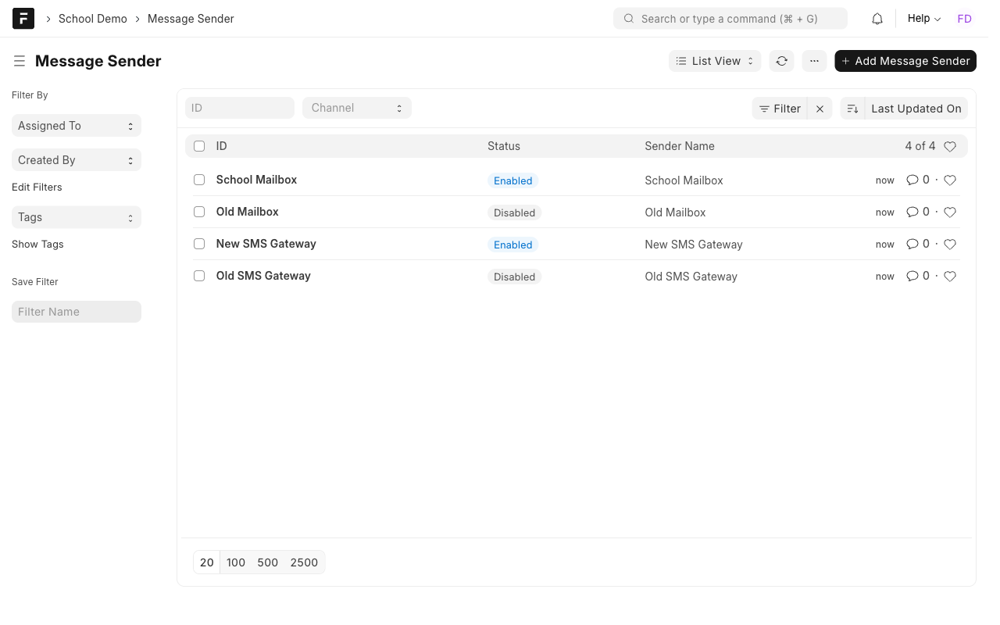
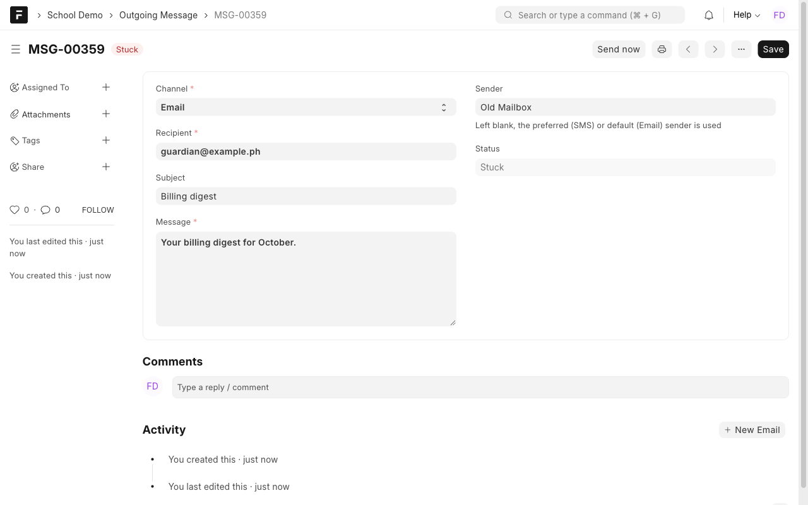
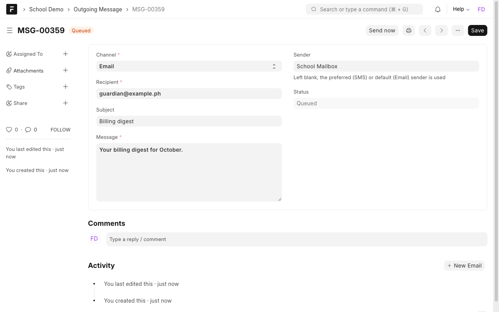
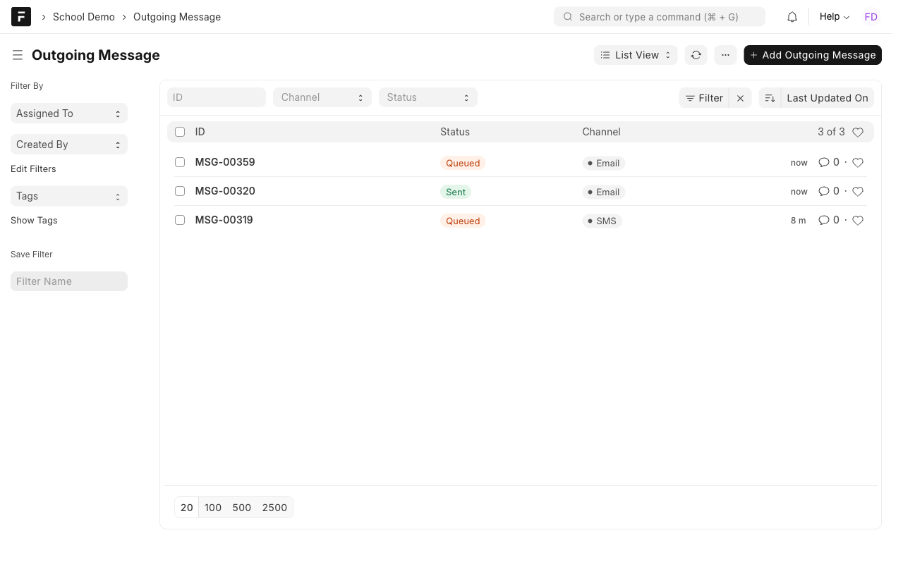
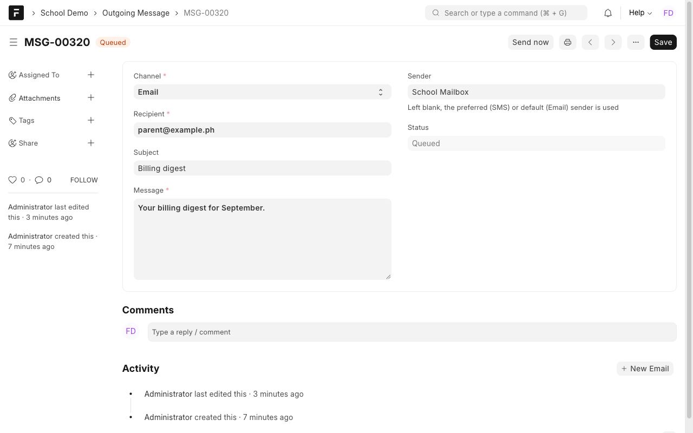
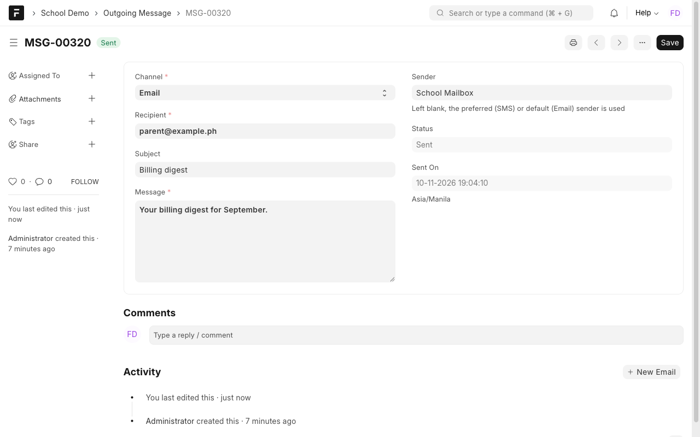

# Manual 4: SMS and email notifications

**What it does.** Billing texts go out through the current SMS provider and email digests go out through a working email account. A message pointed at a disabled sender is flagged **Stuck** and is re-routed through the default email account.

**Who uses it.** Finance Officer and Cashier (messages), System Manager (senders).

> **Try it yourself.** Open the demo, sign in with the login shown for this case study (the password is on the demo's `/demo` page), then open the **School Demo** workspace. Record numbers such as `ASM-00251` differ on every site.

Login: `finance@demo.local`.

## Steps

### 1. Know the senders
**Message Sender** lists each SMS provider and email account, whether it is enabled, and which email account is the default.

In the demo the **old** SMS gateway and the **old** mailbox are disabled on purpose, to show the problem the system solves.

### 2. Queue a message
Open **Outgoing Message** and add one. Choose the channel, the recipient and the text. **Leave Sender blank.** For SMS the system uses the preferred provider from School Settings, and if that one is disabled it falls back to the first enabled provider. For email it uses the default account.

### 3. A stuck message
If a message points at a sender that is disabled or missing, its status is **Stuck**. A stuck message cannot be sent.

### 4. Re-route
Stuck messages are moved to the default email account automatically **every hour** (the scheduler must be on). A Finance Officer or System Manager can also run it on demand by calling `school_demo.messaging.reroute_stuck`; there is no desk button for it. The message moves to the default sender and becomes **Queued**.

### 5. Send
Open a **Queued** message and press **Send now**. Its status becomes **Sent** with the time.

## Rules to know
| Rule | What happens |
| --- | --- |
| Preferred SMS provider is disabled | The first enabled provider is used instead |
| No enabled provider or default email account | A clear message tells you to enable one |
| A sender's channel must match the message | An SMS cannot use an email account |
| Stuck messages cannot be sent | Re-route first |

## Good to know
This demo does not call a real SMS or email provider: **Send now** writes a log line. A real SMS or SMTP client plugs in at one place in the code.

## If something looks wrong
- **A message stays Stuck:** there is no enabled default email account. Open **Message Sender** and mark one as default.
- **The hourly re-route does not run:** turn the scheduler on for the site (`bench --site <site> enable-scheduler`).
