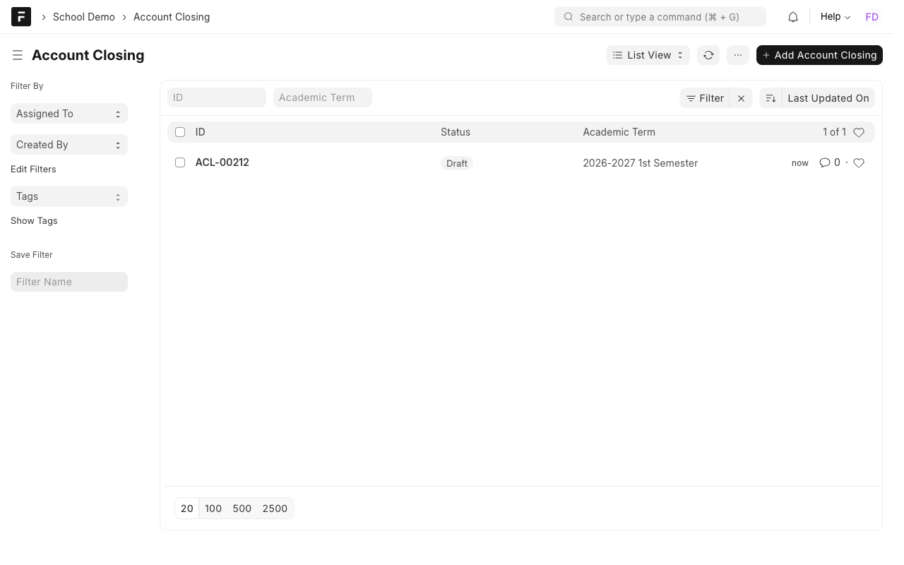
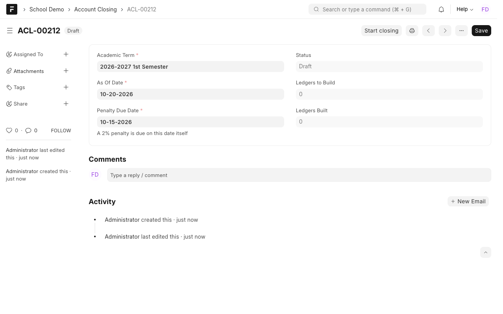
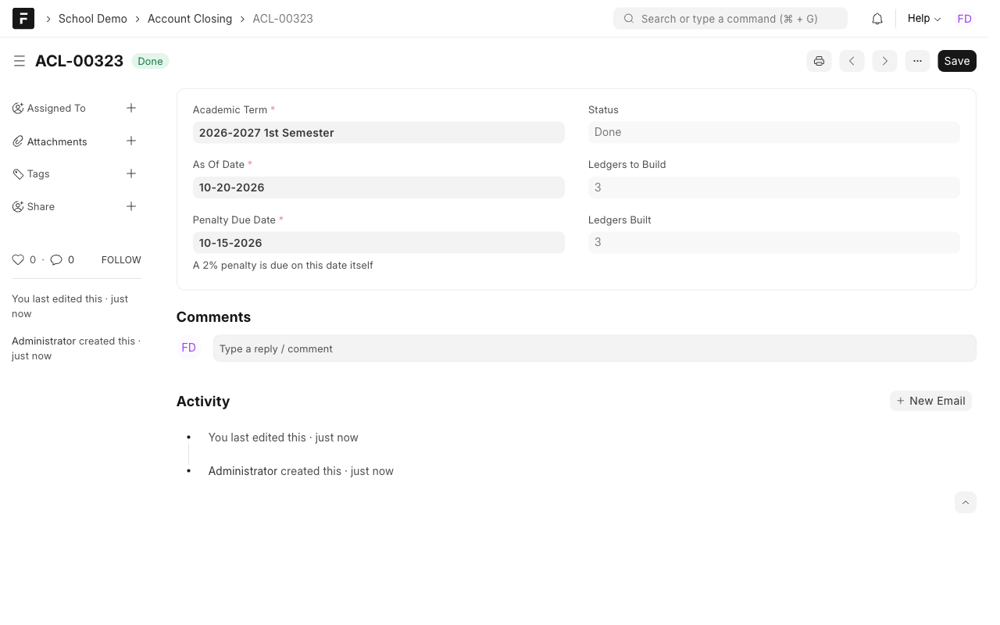
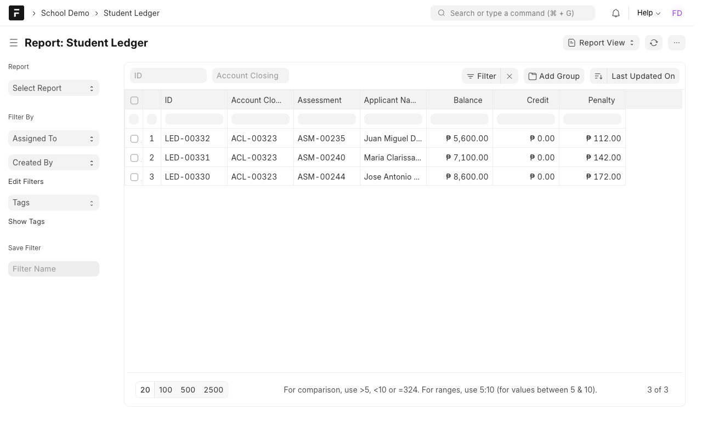
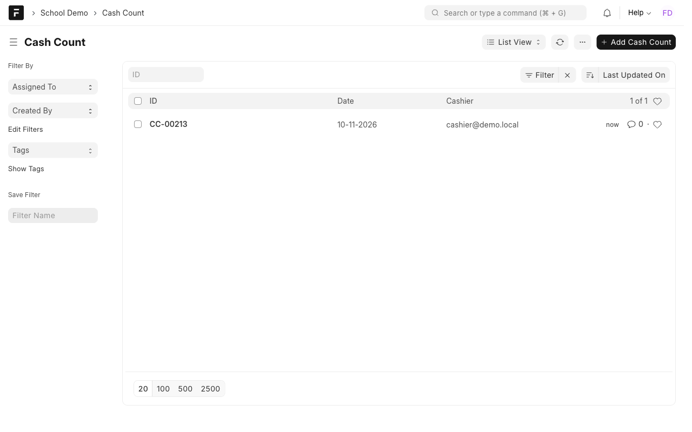

# Manual 5: Account closing and cashiering

**What it does.** At the end of a term the cashier closes the term's accounts. The system builds one ledger per enrolled student in the background, keeps overpayments as credit, and adds a 2% penalty from the due date itself. A cash count compares the cash in the drawer with the payments posted.

**Who uses it.** Cashier and Finance Officer.

> **Try it yourself.** Open the demo, sign in with the login shown for this case study (the password is on the demo's `/demo` page), then open the **School Demo** workspace. Record numbers such as `ASM-00251` differ on every site.

Logins: `finance@demo.local`, `cashier@demo.local`.

## Steps

### 1. Prepare the closing
Open **Account Closing**. Each closing names the **academic term**, an **as-of date** and the **penalty due date**.

### 2. Start closing
Press **Start closing**. The closing can only start when:
- the term is not already closed, and
- there are **no unposted payments** (draft Student Payments for that term). If there are, you get a message such as "1 unposted payment must be posted before 2026-2027 1st Semester can close." Submit those payments and try again.

The work runs in the background. The status goes Queued, Running, then **Done**.

### 3. Read the ledgers
**Student Ledger** has one row per enrolled student: assessment, paid, down payment, balance, credit and penalty.

In the **List** view only a few columns fit. Switch to **Report** view (view menu at the top) to see all of them. In the demo, a student with a balance of 5,600 gets a penalty of 112 (2%).

- **Overpayment** stays on the ledger as **credit**. It is never dropped.
- **Penalty** is 2% of the balance, due **on** the penalty due date (the date itself counts). A student with no balance has no penalty.

### 4. Count the cash
At the end of the day open **Cash Count**. Enter the cash you counted. The form shows the expected amount (submitted payments you received that day) and the variance.

The status is **Balanced**, **Over** or **Short**.

## Rules to know
| Rule | What happens |
| --- | --- |
| Unposted payments block closing | Message names how many |
| A closed term cannot be closed again | "... is already closed" |
| Overpayment | Kept as credit |
| Penalty | 2% of balance, from the due date inclusive |
| A failed closing | Status **Failed** with the error; fix the cause and press Start closing again |

## If something looks wrong
- **Start closing is missing:** the closing is already Queued, Running or Done.
- **Status stays Queued:** the background worker is not running. Start the bench (`bench start`) or its worker.
