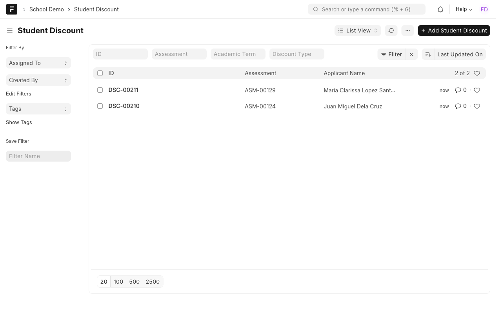
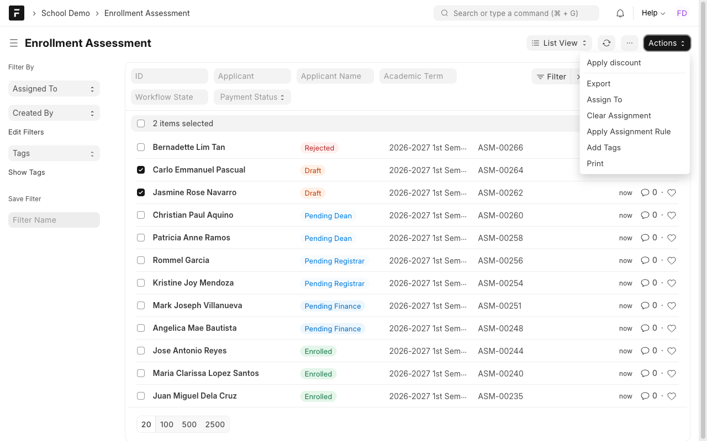
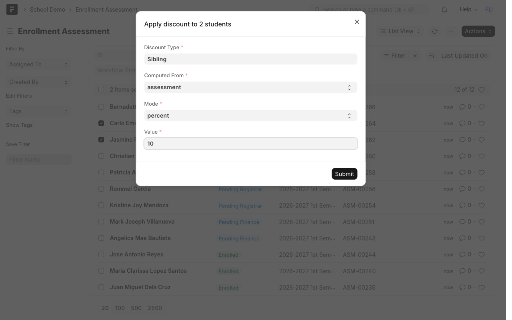
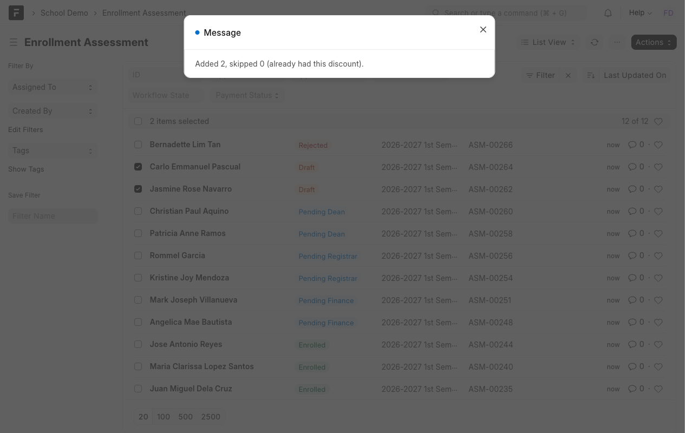
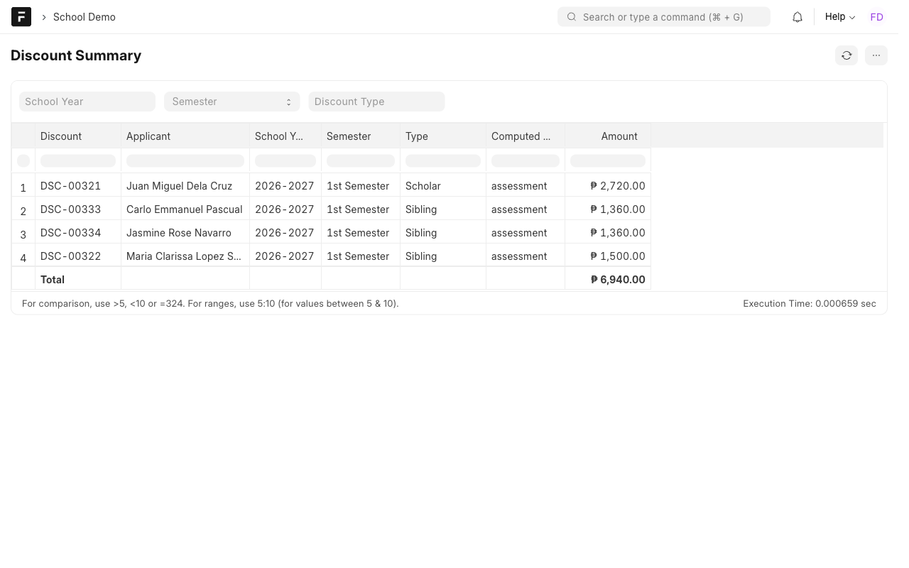

# Manual 6: Student discounts

**What it does.** Finance can see every discount in one place and apply one rule to many students at once, instead of keeping a spreadsheet.

**Who uses it.** Finance Officer.

> **Try it yourself.** Open the demo, sign in with the login shown for this case study (the password is on the demo's `/demo` page), then open the **School Demo** workspace. Record numbers such as `ASM-00251` differ on every site.

Login: `finance@demo.local`.

## Steps

### 1. See the discounts
**Student Discount** lists each discount with the student, type and amount.

A discount is worked out from the **full assessment** or from the **remaining unpaid balance**, as a **percent** or a **fixed** amount. A discount can never be more than the amount it is based on.

### 2. Apply a discount to many students
Open **Enrollment Assessment**, tick the students, then **Actions → Apply discount**.

Fill in the discount type (for example *Sibling*), what it is computed from, percent or fixed, and the value.

Submit. A message says how many were added and how many were skipped. A student who **already has that discount type** is skipped, so running a batch twice does no harm.

### 3. Report
**Discount Summary** lists every discount with its total. Filter by school year, semester and discount type.

## Rules to know
| Rule | What happens |
| --- | --- |
| Value must be above zero | Otherwise refused |
| A percent discount cannot be above 100 | Otherwise refused |
| A discount cannot exceed its base | It is capped at the assessment or balance |
| One discount type per student per assessment | A repeat is skipped in a batch, refused if added by hand |
| Computed from balance | Uses what is unpaid at the time you apply it |
