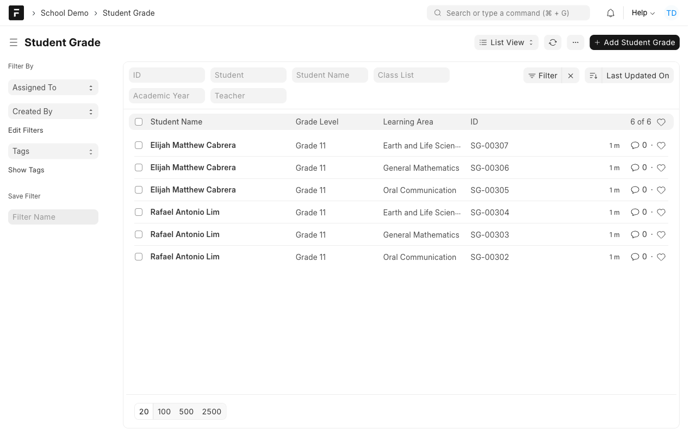
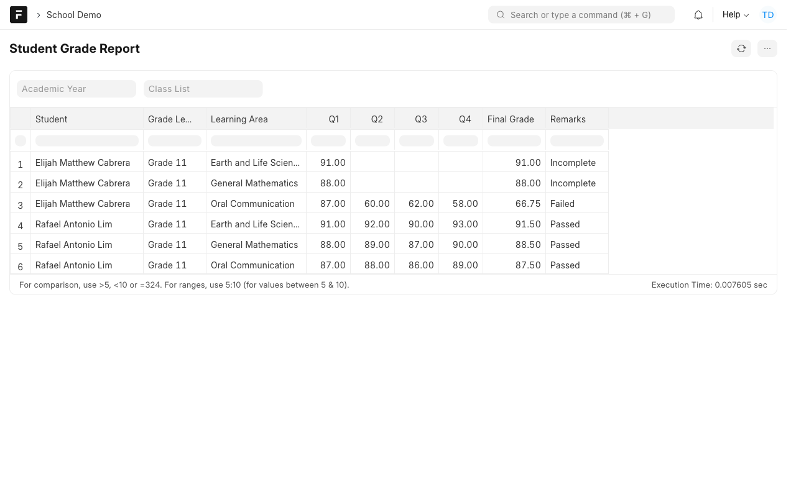
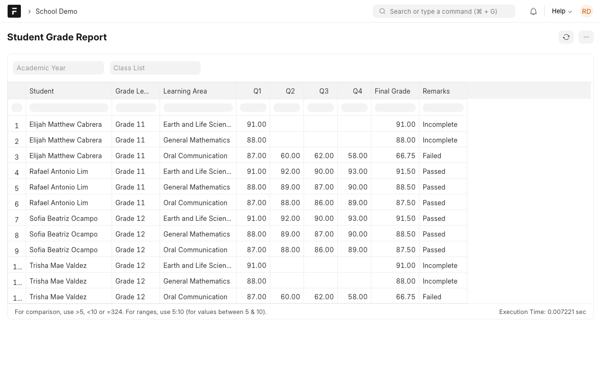

# Manual 7: Grading

**What it does.** Teachers and registrars see grades with the learner's **current** name, validated between 0 and 100, and a printable report with each learning area's final grade and a remark: Passed, Failed or Incomplete.

**Who uses it.** Teacher (own classes), Registrar and Dean (all classes).

> **Try it yourself.** Open the demo, sign in with the login shown for this case study (the password is on the demo's `/demo` page), then open the **School Demo** workspace. Record numbers such as `ASM-00251` differ on every site.

Logins: `teacher@demo.local`, `registrar@demo.local`.

## Steps

### 1. Enter or review grades
**Student Grade** has one record per learner, learning area and quarter (Q1 to Q4). A grade must be a number from 0 to 100. The learner's name is always read from the learner record, so a rename shows up everywhere.

### 2. Open the report
Open **Student Grade Report**. It shows each learner and learning area with Q1 to Q4, the **final grade** and the **remarks**. Use the filters for the academic year or one class list.

A teacher sees only the grades of their own classes. A registrar sees all of them:

### 3. Print
Use the report's **menu (⋯) → Print** or **PDF** for a printable copy.

## How the remark is decided
| Case | Final grade | Remark |
| --- | --- | --- |
| All four quarters entered, average 75 or more | The average | **Passed** |
| All four quarters entered, average below 75 | The average | **Failed** |
| Fewer than four quarters entered | Average so far | **Incomplete** |
| No grades | Blank | **Incomplete** |
