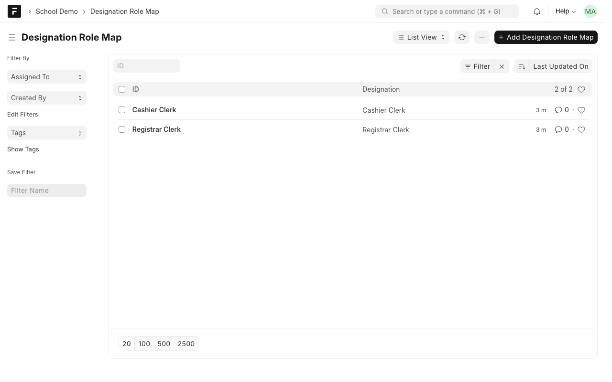
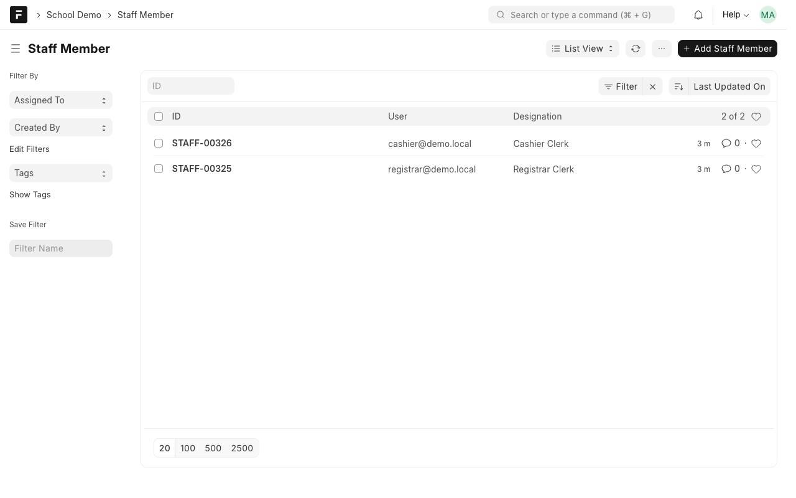
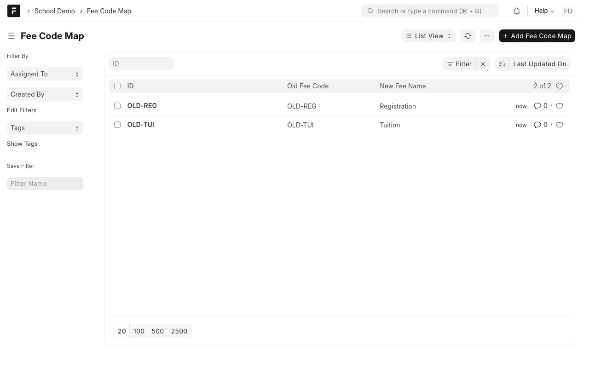
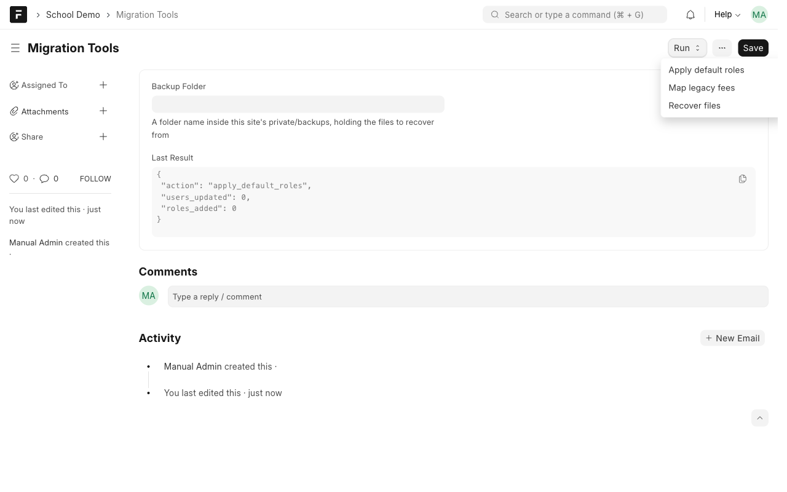
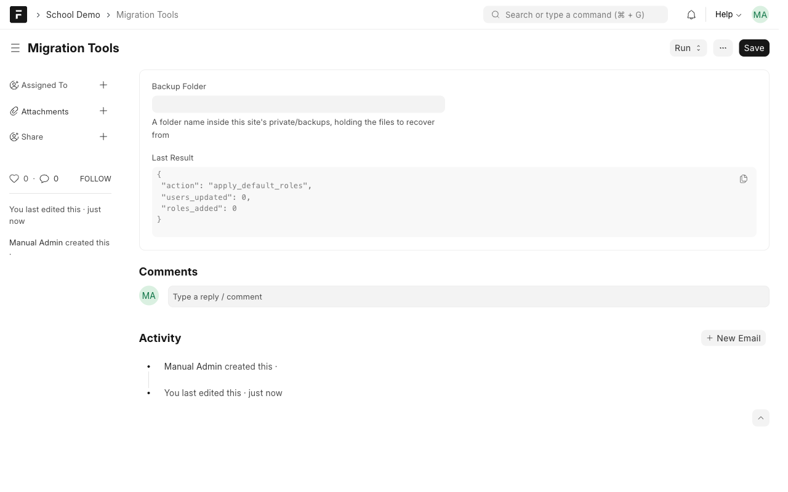
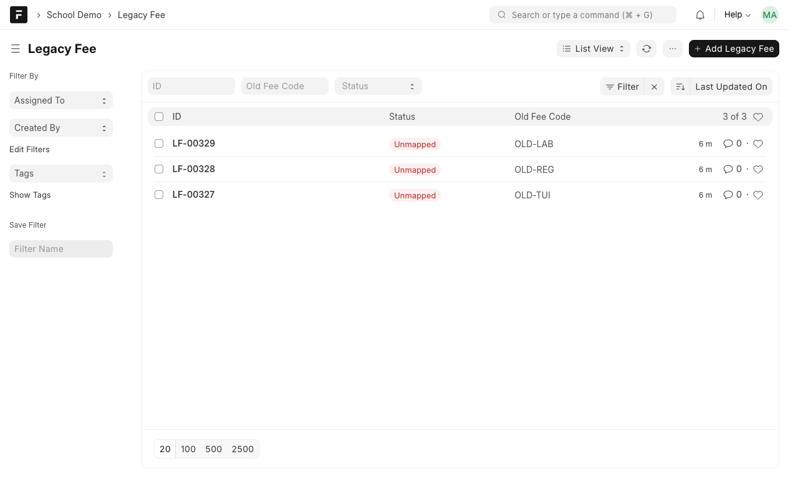
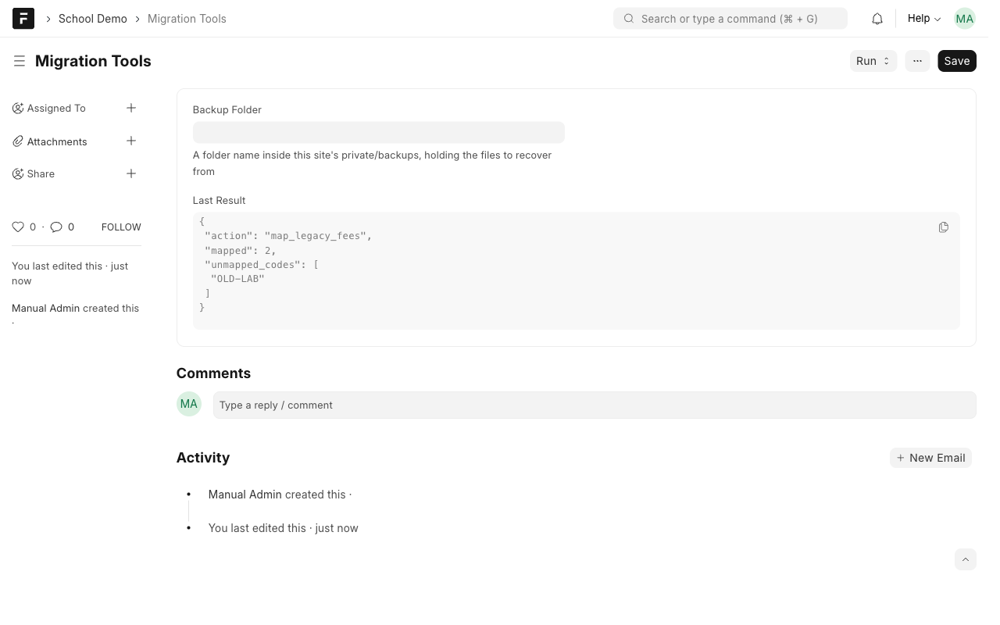
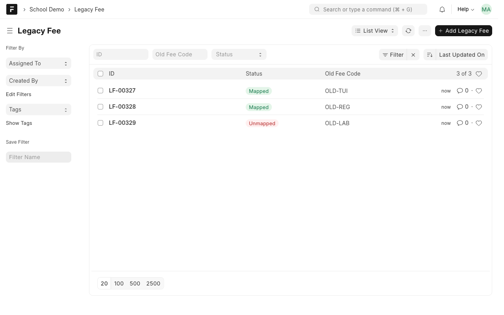

# Manual 8: Roles and data migration

**What it does.** After a platform upgrade, three clean-up jobs bring a site back to a usable state: give staff the roles their designation needs, map old fee codes to the new fees, and recover attachments whose files are missing, without ever overwriting a file that is still there.

**Who uses it.** System Manager (all three, from the Migration Tools screen). A Finance Officer can also call the fee mapping method directly, but cannot open Migration Tools.

> **Try it yourself.** Open the demo, sign in with the login shown for this case study (the password is on the demo's `/demo` page), then open the **School Demo** workspace. Record numbers such as `ASM-00251` differ on every site.

This case study needs a **System Manager** login. The demo logins do not have it; sign in as Administrator.

## Steps

### 1. Set up the mappings
**Designation Role Map** says which roles each designation gets.

**Staff Member** links each user to a designation.

**Fee Code Map** pairs each old fee code with its new fee name.

### 2. Run the clean-up
Open **Migration Tools** and use the **Run** menu.

**Apply default roles.** Each staff member gets the default roles of their designation. Roles they already have are kept, and running it again changes nothing.

**Map legacy fees.** Legacy fee records are pointed at the new fee. A code with no mapping stays **Unmapped** and is listed so you can add it to Fee Code Map.

**Recover files.** Put the backed-up files in a folder inside the site's `private/backups` folder. Type the **folder name** (only the name) in **Backup Folder**, save, then run **Recover files**. A file record whose file is missing is restored from that folder. A file that is already on disk is **kept as it is**. The result counts recovered, kept and not-in-backup.

## Rules to know
| Rule | What happens |
| --- | --- |
| Default roles are added, never removed | Safe to run again |
| An unmapped fee code | Listed in the result and left Unmapped |
| A file already on disk | Never overwritten |
| The backup folder name | Must be a plain folder name inside `private/backups`; paths like `../x` are refused |
| Who can run it | System Manager from Migration Tools (the fee mapping method also allows Finance Officer) |
